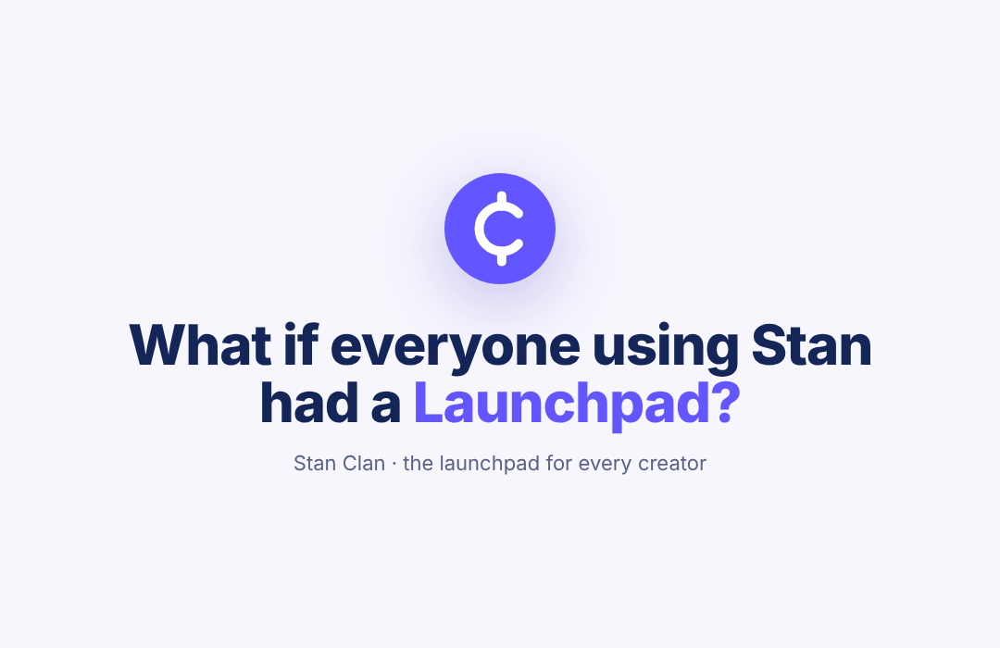

# Stan Clan

**What if everyone using Stan had a Launchpad?**

Live: https://nweinberg97.github.io/Stan-Clan/

A clickable concept for Stan Clan: a private, AI-matched peer network built into Stan, a third pillar alongside Stanley and Stan Store.

Open `index.html` in a browser, or turn on GitHub Pages for this repo (Settings → Pages → deploy from `main`, root) to get a shareable link.

## What's in the prototype

- **Deck tour**: eight chapters from the proposal (the problem, who it's for, matching, your cohort, drop-in, why Stan, three pillars, how it ships). Each chapter drives the phone.
- **Matching**: two-question onboarding, then a matching screen built from data Stan already has.
- **Cohort home**: live office hours, member profiles with headshots, and Demo Friday wins you can post and cheer.
- **Office hours room**: live captions, chat, reactions, raise your hand to speak.
- **Clan directory**: 15 clans with filters; join up to three.
- **Stanley and Store tabs**: both hand off to the cohort.

No build step and no dependencies. Everything is in `index.html` plus `assets/`.

---

Independent concept by Nitai Weinberg, inspired by Launchpad. Not an official Stan product. Stan and Stanley names and logos belong to Stan. Every person, message and number in the prototype is invented. Scene photos and headshots are from Unsplash, used under the Unsplash License. Scene photos by Detail .co, Videodeck .co, Wesley Tingey, Nubelson Fernandes and Vitaly Gariev. Headshots by Aiony Haust, Christian Agbede, Vitaly Gariev, Houcine Ncib, Helena Lopes, OSPAN ALI, Yoad Shejtman, Andrey Zvyagintsev, Hưng Phạm, Michael Dam, Jake Nackos, Troy Spoelma, alex starnes, Brooke Balentine, nrd, Paul Kapischka, Alex Suprun, Vicky Hladynets, Erik Lucatero, Alyona Grishina, Kenzie Kraft, Arthur Debons, Artem Kryzhanivskyi, Anky Lau, Livio Fretz, Levi Meir Clancy and Fernando @cferdophotography.

I'm sharing this because I think it would be really cool if Stan built it.
